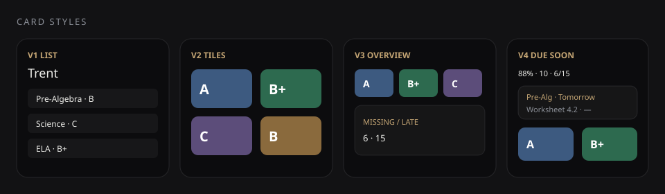
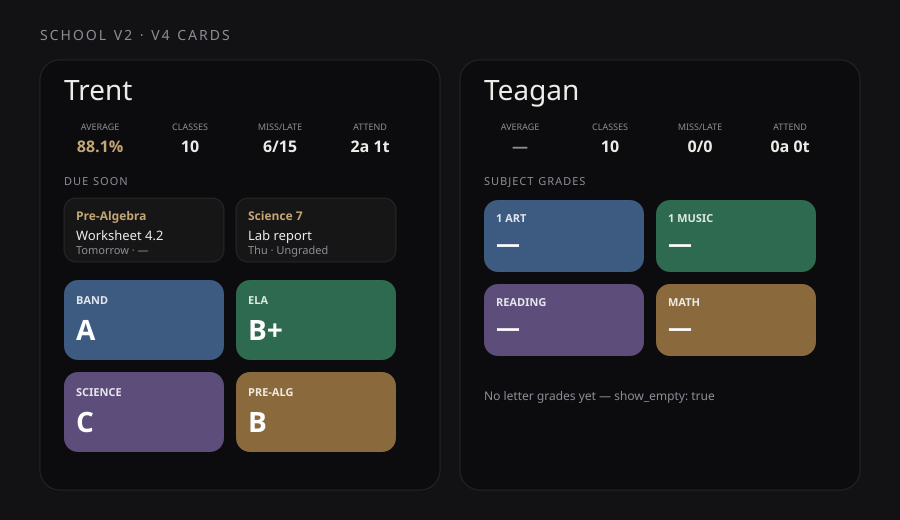

# PowerSchool Grades for Home Assistant

<p align="center">
  
</p>

Unofficial Home Assistant integration for the **PowerSchool Parent Portal**.

Pulls grades, assignments, missing/late work, attendance, schedule, bulletin, class roster, and optional **student photos** for selected students.

**Version:** 1.5.1



## Features

- Config flow setup (portal URL, credentials, students)
- **Multi-district in one entry** — add another portal from Configure (e.g. middle school + future high school)
- Per-student summary sensors (average, missing, late, due soon, absences, …)
- Per-course grade sensors with full assignment attributes
- Binary sensors: has missing work / has late work
- Attendance, schedule periods, bulletin, class roster sensors
- Student profile photos as `entity_picture` (when the portal exposes them)
- Service: `powerschool.refresh`
- Custom Lovelace cards **V1–V4** (V4: due-soon strip, roster/attendance drills)

## Installation

### HACS / Marketplace (recommended)

1. Add custom repository `https://github.com/cjprsnin/powerschool-ha` as **Integration** (if not already listed)
2. Install **PowerSchool Grades** → restart Home Assistant when prompted
3. **Settings → Devices & services → Add integration → PowerSchool Grades**
4. Enter portal URL (e.g. `https://powerschool.yourdistrict.org`), username, password
5. Optional **district name** (shown in titles when you have more than one)
6. Select students → optionally **Add another district**

### Manual

Copy `custom_components/powerschool` into `/config/custom_components/`, restart, then add the integration.

## Configuration

| Field | Description |
|-------|-------------|
| URL | PowerSchool parent portal base URL |
| Username / Password | Guardian login |
| Name | Optional label (e.g. `D41`, `High School`) |
| Students | Which children to track |
| Update interval | 5–1440 minutes (default 30) |

**Options** (integration → Configure):

- Change poll interval
- **Add another district** (same entry, multiple portals)

## Entities (per student)

Entity IDs may be prefixed by area/device (e.g. `sensor.trent_s_bedroom_…`). Patterns:

| Pattern | Description |
|---------|-------------|
| `…_grade_average` | Average of course % grades |
| `…_missing_assignments` / `…_late_assignments` | Counts |
| `…_due_soon_assignments` / `…_upcoming_assignments` | Windows + assignment lists in attributes |
| `…_absences` / `…_tardies` / `…_absent_days` / `…_tardy_days` | Attendance |
| `…_schedule_periods` / `…_bulletin_items` / `…_class_roster` | Schedule, news, roster |
| `…_status` | Diagnostic (identity / last scrape) |
| `…_<course>` | Per-course grade (% or letter) |
| `binary_sensor.…_has_missing_work` / `…_has_late_work` | Problem flags |

Course unique IDs prefer PowerSchool `section_id` so renames do not orphan entities.

## Services

```yaml
action: powerschool.refresh
data: {}
```

Forces an immediate poll of configured PowerSchool entries. No entity target required.

## Lovelace cards



See **[docs/CARDS.md](docs/CARDS.md)** for previews and options.

| Card | Type | Best for |
|------|------|----------|
| V1 | `custom:powerschool-card` | Expandable course list |
| V2 | `custom:powerschool-v2-card` | App-style color tiles |
| V3 | `custom:powerschool-v3-card` | Class overview grid |
| **V4** | `custom:powerschool-v4-card` | Due soon + grades + roster/attendance |

Register as **JavaScript module** resources (Dashboard → Resources), for example:

```text
https://cdn.jsdelivr.net/gh/cjprsnin/powerschool-ha@main/www/powerschool-v4-card.js
```

School dashboard example: [`examples/school-v2-dashboard.yaml`](examples/school-v2-dashboard.yaml)

```yaml
type: custom:powerschool-v4-card
student: Trent
```

## Profile pictures

When the portal exposes a photo, it is cached under `/config/www/powerschool/` and set as `entity_picture` on summary sensors. Re-download is skipped when a local file already exists.

## Notifications

Blueprints live in [`blueprints/automation/`](blueprints/automation/). Import from **Settings → Automations & Scenes → Blueprints → Import blueprint** using a raw GitHub URL, or copy the YAML into `/config/blueprints/automation/powerschool/`.

| Blueprint | When it fires | Sensor to pick |
|-----------|---------------|----------------|
| [Due tomorrow](https://raw.githubusercontent.com/cjprsnin/powerschool-ha/main/blueprints/automation/powerschool_due_tomorrow.yaml) | Daily at 17:00 (configurable) if any **ungraded** work is due tomorrow | `…_upcoming_assignments` |
| [Due soon](https://raw.githubusercontent.com/cjprsnin/powerschool-ha/main/blueprints/automation/powerschool_due_soon.yaml) | When the due-soon **count increases** | `…_due_soon_assignments` |
| [Missing / late](https://raw.githubusercontent.com/cjprsnin/powerschool-ha/main/blueprints/automation/powerschool_missing_work.yaml) | When missing or late **count increases** | `…_missing_assignments` and `…_late_assignments` |

`powerschool_due_today.yaml` is a **legacy filename** for the same due-tomorrow digest — prefer `powerschool_due_tomorrow.yaml` for new automations.

### Setup tips

1. Create **one automation per student** (or one shared notify service).
2. **Notify service** must be the full service id, e.g. `notify.mobile_app_iphone`.
3. Due-soon and missing/late support **quiet hours** (default 22:00–07:00).
4. Assignment lists on due-soon / upcoming sensors are **ungraded only** — graded work does not affect averages or these digests.

Example import URL:

```text
https://raw.githubusercontent.com/cjprsnin/powerschool-ha/main/blueprints/automation/powerschool_due_tomorrow.yaml
```

## Notes

- Uses the guardian/parent portal (not a public district API)
- Poll reasonably; default is **30 minutes**
- First refresh after restart runs in the background so HA startup is not blocked
- PowerSchool entities are not required in HomeKit; keep them out of include lists if you hit the device limit

## Support

- Issues: [github.com/cjprsnin/powerschool-ha/issues](https://github.com/cjprsnin/powerschool-ha/issues)
- Changelog: [CHANGELOG.md](CHANGELOG.md)
