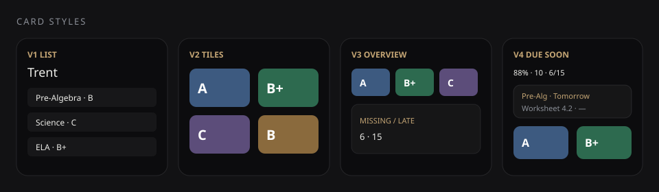

# PowerSchool Grades for Home Assistant

<p align="center">
  
</p>

<p align="center">
  <strong>Unofficial</strong> Home Assistant integration for the PowerSchool Parent Portal<br/>
  Grades · assignments · missing/late · attendance · schedule · bulletin · roster · photos
</p>

<p align="center">
  <a href="https://cjprsnin.github.io/powerschool-ha/demo/"><strong>Interactive card demo</strong></a>
  ·
  <a href="docs/CARDS.md">Card docs</a>
  ·
  <a href="CHANGELOG.md">Changelog</a>
</p>

**Version:** 1.5.1



## Features

- Config flow setup (portal URL, credentials, students)
- **Multi-district in one entry** — add another portal from Configure
- Per-student summary sensors (average, missing, late, due soon, absences, …)
- Per-course grade sensors with assignment attributes
- Binary sensors: has missing work / has late work
- Attendance, schedule, bulletin, class roster
- Student photos as `entity_picture` when the portal exposes them
- Service: `powerschool.refresh`
- Custom Lovelace cards **V1–V4** (V4: due-soon strip, roster/attendance drills)

## Installation

### HACS / Marketplace (recommended)

1. Add custom repository `https://github.com/cjprsnin/powerschool-ha` as **Integration** (if needed)
2. Install **PowerSchool Grades** → restart when prompted
3. **Settings → Devices & services → Add integration → PowerSchool Grades**
4. Enter portal URL, username, password
5. Optional **district name** when you track more than one
6. Select students → optionally **Add another district**

### Manual

Copy `custom_components/powerschool` into `/config/custom_components/`, restart, then add the integration.

## Configuration

| Field | Description |
|-------|-------------|
| URL | Parent portal base URL |
| Username / Password | Guardian login |
| Name | Optional label (e.g. `D41`) |
| Students | Which children to track |
| Update interval | 5–1440 minutes (default **30**) |

**Options** (integration → Configure): change poll interval · **Add another district**

## Entities (per student)

| Pattern | Description |
|---------|-------------|
| `…_grade_average` | Average of course % grades |
| `…_missing_assignments` / `…_late_assignments` | Counts |
| `…_due_soon_assignments` / `…_upcoming_assignments` | Windows + assignment lists |
| `…_absences` / `…_tardies` / `…_absent_days` / `…_tardy_days` | Attendance |
| `…_schedule_periods` / `…_bulletin_items` / `…_class_roster` | Schedule, news, roster |
| `…_status` | Diagnostic |
| `…_<course>` | Per-course grade |
| `binary_sensor.…_has_missing_work` / `…_has_late_work` | Flags |

## Services

```yaml
action: powerschool.refresh
data: {}
```

Forces an immediate poll. No entity target required.

## Lovelace cards

Try the **[interactive demo](https://cjprsnin.github.io/powerschool-ha/demo/)** (sample data, V4 & V2).

Full options: **[docs/CARDS.md](docs/CARDS.md)**

| Card | Type | Best for |
|------|------|----------|
| V1 | `custom:powerschool-card` | Expandable course list |
| V2 | `custom:powerschool-v2-card` | App-style color tiles |
| V3 | `custom:powerschool-v3-card` | Class overview grid |
| **V4** | `custom:powerschool-v4-card` | Due soon + grades + roster/attendance |

Register as **JavaScript module** resources, for example:

```text
https://cdn.jsdelivr.net/gh/cjprsnin/powerschool-ha@main/www/powerschool-v4-card.js
```

<details>
<summary><strong>V4 YAML (recommended)</strong></summary>

```yaml
type: custom:powerschool-v4-card
student: Trent
```

```yaml
type: custom:powerschool-v4-card
student: Teagan
show_empty: true
```

School page: [`examples/school-v2-dashboard.yaml`](examples/school-v2-dashboard.yaml)

</details>

<details>
<summary><strong>V1 / V2 / V3 YAML</strong></summary>

```yaml
type: custom:powerschool-card
student: Trent
scope: current
recent: 10
```

```yaml
type: custom:powerschool-v2-card
student: Trent
```

```yaml
type: custom:powerschool-v3-card
student: Teagan
```

More: [`examples/lovelace-cards-v1-v2-v3.yaml`](examples/lovelace-cards-v1-v2-v3.yaml)

</details>

## Notifications

Blueprints in [`blueprints/automation/`](blueprints/automation/). Import via **Settings → Automations → Blueprints**.

| Blueprint | Fires when | Sensor |
|-----------|------------|--------|
| [Due tomorrow](https://raw.githubusercontent.com/cjprsnin/powerschool-ha/main/blueprints/automation/powerschool_due_tomorrow.yaml) | Daily ~17:00 if ungraded work is due tomorrow | `…_upcoming_assignments` |
| [Due soon](https://raw.githubusercontent.com/cjprsnin/powerschool-ha/main/blueprints/automation/powerschool_due_soon.yaml) | Due-soon count increases | `…_due_soon_assignments` |
| [Missing / late](https://raw.githubusercontent.com/cjprsnin/powerschool-ha/main/blueprints/automation/powerschool_missing_work.yaml) | Missing or late count increases | `…_missing_assignments` / `…_late_assignments` |

## Notes

- Guardian/parent portal scrape (not a public district API)
- Default poll **30 minutes**
- First refresh after restart runs in the background
- Keep PowerSchool entities out of HomeKit include lists if you hit device limits

## Support

- Issues: [github.com/cjprsnin/powerschool-ha/issues](https://github.com/cjprsnin/powerschool-ha/issues)
- Changelog: [CHANGELOG.md](CHANGELOG.md)
- Quality notes: [docs/QUALITY.md](docs/QUALITY.md)
